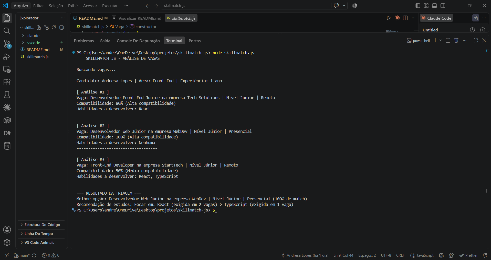

# SkillMatch JS

Simulador em JavaScript puro que compara meu perfil técnico com os requisitos de vagas de front-end júnior e mostra o quanto eu atendo a cada uma delas.

Mini-projeto avaliativo do Módulo 01 
Desenvolvedor Front-End [React], Turma 03.

## O que o sistema faz

O programa cruza dados de meu perfil com uma lista de vagas buscadas em um servidor simulado. Ele calcula o percentual de compatibilidade de cada oportunidade, categoriza o nível de aderência (Alta, Média ou Baixa) e destaca a vaga com maior alinhamento. Por fim, o sistema mapeia as lacunas de conhecimento de cada posição e sugere um plano de estudos priorizado para o desenvolvimento do usuário.

Todo o resultado é impresso no console.

## Como executar

**Pré-requisito:** ter o [Node.js](https://nodejs.org) instalado.

1. Baixe ou clone este repositório:
   ```bash
   git clone https://github.com/<usuario>/skillmatch-js.git
   ```
2. Abra o terminal na pasta do projeto:
   ```bash
   cd skillmatch-js
   ```
3. Execute o arquivo:
   ```bash
   node skillmatch.js
   ```

O relatório aparece no terminal depois de cerca de 1,5 segundo, esse atraso é proposital e simula a espera por um servidor.
Também é possível rodar sem instalar nada: abra o console do navegador (`F12` → aba *Console*), cole o conteúdo de `skillmatch.js` e pressione Enter.

### Saída esperada

```
=== SKILLMATCH JS - ANÁLISE DE VAGAS ===

Buscando vagas...

Candidato: Andresa Lopes | Área: Front End | Experiência: 1 ano

[ Análise #1 ]
Vaga: Desenvolvedor Front-End Júnior na empresa Tech Solutions | Nível Júnior | Remoto
Compatibilidade: 80% (Alta compatibilidade)
Habilidades a desenvolver: React
-----------------------------------

...

=== RESULTADO DA TRIAGEM ===
Melhor opção: Desenvolvedor Web Júnior na empresa WebDev | Nível Júnior | Presencial (100% de match)
Recomendação de estudos: Focar em: React (exigida em 2 vagas) > TypeScript (exigida em 1 vaga)
```

## Regra de cálculo da compatibilidade

O percentual é a razão entre os requisitos da vaga que eu atendo e o total de requisitos dela:

```
compatibilidade = (requisitos atendidos / total de requisitos da vaga) × 100
```

O resultado é arredondado com `Math.round()`.

**Por que escolhi essa regra:** ela mede o quanto eu atendo *a vaga*, e não o quanto a vaga aproveita o meu currículo. Se eu dominasse dez tecnologias e a vaga pedisse quatro que eu tenho, a compatibilidade continuaria sendo 100% porque, do ponto de vista de quem contrata, o perfil atende ao que foi pedido. Dividir pelo total de requisitos de cada vaga também permite comparar vagas que exigem quantidades diferentes de tecnologias.

### Classificação

| Percentual | Classificação |
| :---- | :---- |
| 80% a 100% | Alta compatibilidade |
| 50% a 79% | Média compatibilidade |
| 0% a 49% | Baixa compatibilidade |

A faixa é definida com `if` encadeado na função `classificarCompatibilidade()`.

## Critério de priorização dos estudos

A recomendação não lista as habilidades faltantes em ordem aleatória. O programa conta **em quantas vagas cada habilidade faltante aparece** e ordena da mais pedida para a menos pedida.
O motivo é prático: estudar primeiro o que destrava mais vagas de uma vez. No cenário atual, React aparece em 2 das 3 vagas e TypeScript em 1, então a recomendação sai como:

```
Focar em: React (exigida em 2 vagas) > TypeScript (exigida em 1 vaga)
```

## Arquitetura cliente-servidor

Nesse modelo existem dois papéis. O **cliente** é quem pede alguma coisa (o navegador, um aplicativo, o meu programa). O **servidor** é a máquina que guarda os dados e responde ao pedido. O cliente nunca acessa o banco de dados direto: ele faz uma requisição, espera, e recebe a resposta.
Essa espera é o ponto importante — a resposta não é instantânea, porque os dados precisam viajar pela rede.
No projeto isso aparece na função `buscarVagasDoServidor()`. Ela devolve uma `Promise` que só entrega a lista de vagas depois de 1,5 segundo (`setTimeout`), simulando a demora de uma requisição real. A função `rodarSimulador()` usa `async/await` para esperar essa resposta antes de gerar o relatório. Se o servidor não devolvesse nenhuma vaga, a `Promise` seria rejeitada e o `try/catch` mostraria a mensagem de erro em vez de quebrar o programa.

## Como a internet funciona

Quando eu digito um endereço no navegador, ele não sabe onde o site está. Primeiro o **DNS** traduz o domínio (por exemplo `google.com`) para um endereço **IP**, que é o número que identifica o servidor na rede.
Com o IP em mãos, o navegador monta uma requisição **HTTP** e a envia. Essa requisição é quebrada em pacotes que atravessam roteadores e cabos até chegar ao servidor. O servidor processa o pedido e devolve uma resposta — normalmente HTML, CSS, JavaScript ou dados em JSON. O navegador recebe tudo isso e monta a página na tela.
É por isso que uma página nunca carrega instantaneamente: existe um caminho físico sendo percorrido a cada requisição. Foi essa espera que eu simulei no projeto com o `setTimeout`.

## Sobre var, let e const

No projeto eu usei apenas `const` e `let`. Não usei `var`.

- **`const`** é o padrão do arquivo. Uso quando o valor não vai ser reatribuído — o perfil do candidato, a lista de vagas, os resultados das análises. Vale lembrar que `const` impede a reatribuição, mas não congela o conteúdo: por isso consigo usar `push()` no array `todasTecnologiasFaltantes` mesmo ele sendo `const`.
- **`let`** aparece só onde o valor realmente muda: o `contador` dentro da closure e o `i` dos laços `for`.
- **`var`** é a forma antiga de declarar variável. Ela tem escopo de função (e não de bloco), pode ser redeclarada sem erro e sofre *hoisting* — ou seja, é possível usá-la antes da linha em que foi declarada, e o valor vem `undefined` em vez de dar erro. Isso facilita bugs difíceis de achar, e é justamente o que `let` e `const` vieram corrigir.

## Conceitos do Módulo 01 e onde estão no código

| Conceito | Onde está |
| :---- | :---- |
| Objetos | `candidato` (linha 1) |
| Arrays | `habilidades` (linha 4), `vagas` (linha 33) |
| Strings, números e booleanos | perfil (linhas 1-6) e vagas (linhas 33-37) |
| Classe e construtor | `Vaga` (linha 8) |
| Herança | `VagaFrontend extends Vaga` (linha 20) |
| Sobrescrita de método | `exibirResumo()` na subclasse (linha 27) |
| `this` | linhas 10-12, 23-24, 28-29 |
| Promise | `buscarVagasDoServidor()` (linha 41) |
| `async/await` | `rodarSimulador()` (linhas 124 e 128) |
| Tratamento de erro | `try/catch` (linhas 127 e 160) |
| Closure | `criarContador()` (linha 53) |
| Callback | `processarRelatorios()` (linha 63) |
| Laço `for` | linhas 64 e 98 |
| `if` / condicionais | `classificarCompatibilidade()` (linhas 88-91) |
| Operador ternário | linhas 28, 73, 112, 129, 154 |
| `filter` | `obterFaltantes()` (linha 78) |
| `map` | linhas 110 e 134 |
| `reduce` | vaga mais compatível (linha 153) |
| `sort` | ordenação dos estudos (linha 108) |
| Arrow functions | linhas 78, 108, 134, 153 |
| Funções | todas as regras estão separadas em funções próprias |

## Ferramentas

Editor: **Visual Studio Code**.

Extensões:

- **Code Runner** — executa o arquivo `.js` direto no editor, sem precisar do terminal;
- **ESLint** — aponta erros de sintaxe e problemas no código enquanto escrevo;
- **Prettier** — mantém a formatação e a indentação consistentes.

## Organização do trabalho

O projeto foi organizado em um quadro Kanban com as colunas *Backlog*, *A Fazer*, *Em Andamento* e *Concluído*, e o desenvolvimento foi dividido em branches:

- **`feature/modelagem-vagas`** — criação do perfil do candidato, das classes `Vaga` e `VagaFrontend` e da busca simulada com `Promise` e `async/await`;
- **`feature/regra-compatibilidade`** — cálculo do percentual, classificação por faixa, listagem das habilidades faltantes, recomendação de estudos, revisão final do código e documentação.

**Quadro Kanban:** https://trello.com/b/hE8lE69W/skillmatch-js-kanban

## Vídeo de apresentação

_(https://www.loom.com/share/ad5bec83a41740d7bf401457a91d1690)_

## Aplicação rodando

Relatório gerado no terminal integrado do VS Code com o comando `node skillmatch.js`:


